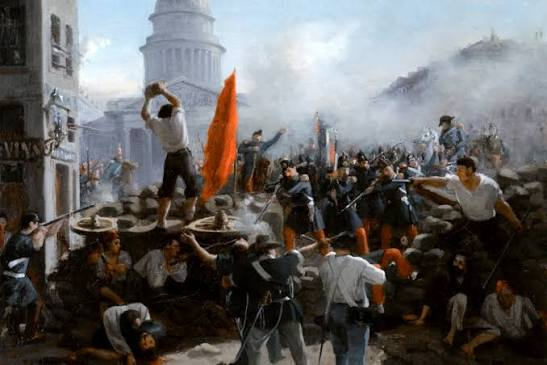
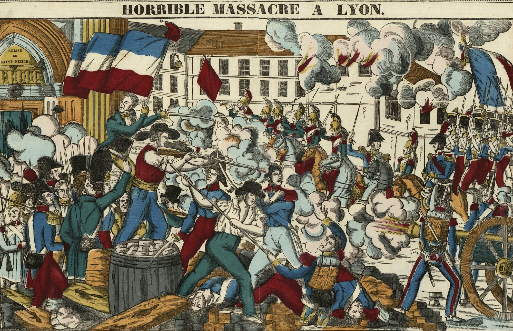
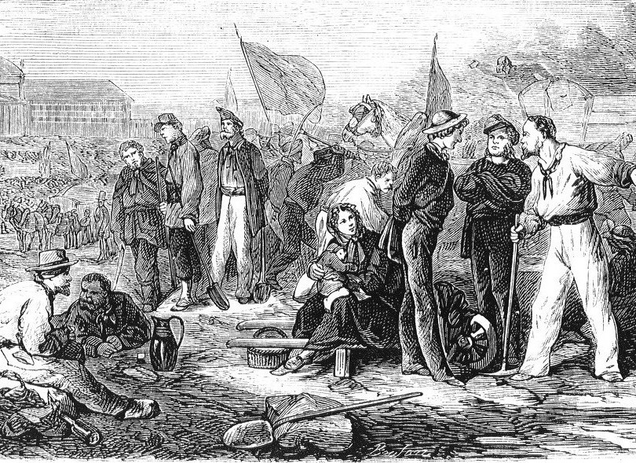
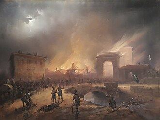

> This post was written with a relatively technical audience in mind. If you want to know more about these historical events (which you should!), take a look at Jonathan Sperber’s *The European Revolutions, 1848-1851*, especially the first two chapters (available [here](https://www.cambridge.org/core/books/european-revolutions-18481851/F2D2AD7C081F94CE42946624E2FD537F)).

On Friday, November 20th, 2026, the Riemann Hypothesis—one of the greatest questions of mathematics, which remained unsolved for over 150 years and held a million-dollar bounty—was (supposedly) solved by Levent Alpöge and Claude. If the proof were to be directly turned into natural language, it would span over 250,000 pages, far more than any human could reasonably verify. This follows a string of AI-assisted proofs of major mathematical problems. It seems reasonable to say that soon, perhaps even in just a few months, the frontier of math will be outside the reach of any human.

Three years ago, even the best LLMs couldn’t add numbers, count the number of ‘r’s in strawberry, or sort a list of five numbers in increasing order. Even just two years ago, AI couldn’t solve problem 6 of the International Math Olympiad (IMO). If someone told me back then that, by November 2026, both Navier-Stokes and the Riemann Hypothesis would be solved in large part due to AI, I would’ve easily dismissed them.[^1] I think that many of you reading this would share that sentiment.

Yet AI has changed, and it seems to exceed us in many ways. Some form of superintelligence seems to be imminent, with the median timeline of roughly 2028. This raises an immediate question:

> What do we do when AI can do everything better than us?

Of course, there are many credible arguments as to why work will remain relevant in the short- and medium-term, and there is no guarantee that we’ll even reach that form of intelligence. However, math research has already been fundamentally altered by the current advances in AI. To every math researcher, that hypothetical question is reality. Why do math research when ChatGPT or Claude could just solve it for you? Math researchers may be left to verify AI-generated proofs, or math research as a concept might disappear into the dustbin of history.[^2]

While technology-driven job displacement is a natural part of history, this sort of AI-driven displacement empirically feels different from many of these other patterns. One aspect is the removal of an entire type of work, rather than just one specific job. Work that required intelligence and technical skill feels particularly vulnerable to AI.

This post walks through the last stands of European artisans, identifying four challenges that these skilled workers faced in the early 19th century. These characteristics feel suspiciously similar to the challenges facing math researchers today. In a follow-up post, I’ll make that connection, taking a detour through Hollywood writers in the process.

---

## European Artisans in the Early 19th Century

Urban artisans—tailors, shoemakers, carpenters, printers, weavers, and other “skilled” laborers—were an integral part of most pre-industrial societies. Starting in the Middle Ages, people doing similar things, including artisans in each profession, began to form associations for mutual aid. They protected each other physically, controlled town markets to fight for higher prices, and dominated city governance.[^3] Over time, they grew into large, structured organizations, setting prices and restricting entry in an attempt to gain more power within the system.

These guilds were some of the first targets for free-market thinkers during the Enlightenment. They restricted trade and fixed prices, decreasing the incentive for people to produce quality goods outside of the system. In the French Revolution, guilds were abolished as being counter-revolutionary, with the Le Chapelier law arguing that no “intermediary” body should come between the nation and the people. Elsewhere in Europe, the situation was only mildly better. While the German states and the Austrian Empire allowed guilds to continue into the nineteenth century, policies like the German Customs Union (*Zollverein*) encouraged free trade, which inevitably hurt the artisan class.

These artisans became the actual fighters in the Revolutions of 1848, also known as the Springtime of the People. However, these battles were by no means the beginning of a new era for the artisan class. Instead, it marked a last stand by a diminishing class, seeking to find protection in a changing world. They looked backward into history, wanting to bring back the strength of the guild system and a guarantee of their job, their future, and their dignity.[^4] For this post, I’ve identified four key areas that brought distress to these artisans:

1. The breakdown of the guild system
2. Lowered standards of living
3. Exclusion from meaningful representation
4. The degradation of work

## The Breakdown of the Guild System

The traditional guild system worked as follows:

1. Apprentice. Young learners, usually in their early to mid teens, entered a master’s household and worked without pay for several (two to seven, depending on the type of work) years. Here, they learned the specific trade from the masters, often with harsh punishment for mistakes.
2. Journeymen. After completing their apprenticeship, these workers were allowed to leave the house to work for wages. They often wandered through various cities, competing with other journeymen for social standing. By the late 18th and early 19th century, many artisans were unable to become masters, thus being forced to remain wage workers.
3. Masters. The top of the ladder. They were able to make their own shops, take on apprentices, and generally enjoy a relatively high standard of living for the time.

By 1848, most apprentices and journeymen knew that they would likely never reach the position of a master. One of the reasons that young men looking to climb the social ladder decided to become an apprentice was the future promise of becoming a master. Without this guarantee, the system, already broken in France, began to break down across central Europe.

As apprentices and journeymen became fewer in number, the work-life relationship began to change. Rather than apprentices living with masters, which necessarily became personal relationships, young men separated their life from their work. The relationship between an apprentice and a master became that of an employer and an employee[^5] rather than of a (admittedly harsh) mentor and a student. This change meant that even the promise of apprentices and wealth to masters became moot. Our artisans, especially the younger apprentices, felt angry and resentful toward the system. They felt despair, looking at a bleak future, and, as we’ll discuss next, an even bleaker present.

## Lowered Standards of Living

The 1840s were not the best times to live in Europe. The decade is often referred to as the “Hungry Forties,”[^6] marked especially by the potato famine that decimated Ireland. As the hunger spread throughout Europe, prices for essential goods, especially food, increased drastically. In turn, the demand for less essential goals—those that our artisans produced, like leather jackets, fancy shoes, and intricate pieces of furniture—collapsed. Even worse for the artisans, the food crisis was matched by a financial crisis, meaning that even the wealthy suffered in the late 1840s. By 1848, even the previously prosperous artisans were facing acute hunger and poverty.

This crisis combined with the ever-present phenomenon of urbanization. While industrialization was not yet common (we’ll talk more about this in *The Removal of a Sense of Meaning*), a sharp increase in the population meant that young people were forced to move to the cities to look for work. This led to a surplus of labor in the cities, which often left artisans with two choices: underemployment and unemployment. In the former, they took on unskilled jobs for low pay, while in the latter, they waited for improved conditions and relied on mutual aid to get through this time period. In both cases, however, many felt a loss of dignity and a desire to return to their prosperous past.

## Exclusion from Meaningful Representation

The men and women of Paris led the overthrow of the conservative, absolutist Bourbon monarchy and King Charles X, in late July, 1830. The July Revolution, and the succeeding July Monarchy with King Louis Philippe I, was a rebellion against the perceived tyranny of the restored Bourbon regime. The so-called liberals helped orchestrate this regime change, changing the monarch’s title from the King of France to the King of the French. The king’s power was not granted by God, but instead granted by the people of France—he ruled over the people of France, not the land that France occupied. The king would be the people’s king—the Citizen King.

With all this talk of liberalism and the people, one might expect a broad base of voters, allowed to voice their opinions to their own monarch. Indeed, one key piece of legislation that triggered the July Revolution was the “Law of the Double Vote.” Even without this law, only men over the age of 30 who paid at least 300 francs in taxes were allowed to vote. This meant that out of the roughly 30 million people living in France, only 94,000, or about .3%, had the right to vote. With this new bill, a new section of the chamber was formed, whose voting base would encompass the top 25% of these 94,000 men, or about .75% of the entire population.

So what did the liberal reforms mean for suffrage in France? The July monarchy allowed men over the age of 25 who paid at least 200 francs in taxes to vote—which meant that somewhere between 150,000 and 200,000 people could cast a ballot, still far less than 1% of the entire population.

Our artisans were not in the top 1% of France. Most artisans would never be able to vote; in fact, even the richest artisans often lacked the ability to vote, in part due to the fact that urban taxes were often excluded from the calculation of taxes for the purposes of voting. Even outside of the ballot box, artisans lacked the ability to voice their concerns to the government. Louis Philippe feared the power of large organizations of the people—arguably justified, considering that his cousin, King Charles X, had been overthrown by mobs of Parisians. In 1831, the government banned large assemblies, and following the Canut revolts of 1831 and 1834, the government also banned small assemblies of less than 20 people.

Now, keep in mind that France was the most liberal country of all continental Europe. German and Austrian liberals envied the charter of government, which (attempted to) guarantee the rule of law. In Russia, the idea of the people voting was considered alien. Altogether, this left our artisans without even the semblance of representation and a desire to gain that representation to protect their way of life.

## The Degradation of Work

Artisans took pride in their work, and often, for good reason. One requirement to become a master was the “masterpiece,” a work displaying technical mastery of their craft. This work was then judged by senior members of the guild, and approval was rare, especially in the early 19th century.

Often, the removal of meaning and pride from the artisans’ work is linked to the Industrial Revolution. However, while parts of Britain, northeastern France, and the Rhineland were somewhat industrialized by 1848, the rest of Europe was still in a stage of proto-industrialization. Factories were rare, and almost non-existent, for most of Germany and Austria.

However, most of Europe did see a rise in “machine-less factories” in the early 1800s. Specifically, the practice of subcontracting and the division of labor increased efficiency, spreading the practice around Europe. Previously, a master would make a shoe for his client, perhaps forcing some of his apprentices or journeymen to bind pieces of leather. However, in this new era, the shoe-making process would look something like:

1. The client would request a shoe to be made at a shop and would be referred to a master.
2. The master would fit the sole to the foot of the client, then send it to a group of journeymen.
3. The journeyman would shape the leather to fit the sole, then send it to groups of women.
4. The women would bind the leather together, forming the actual shoe, then send it back to the shop.
5. The shop would sell the shoe to the client, pay the master a contracting fee, and keep the rest of the profits to themselves.

This increased the reliance on capitalist merchants, while decreasing the quality of life for masters, journeymen, and other people involved in this process, since they relied on the processing fees given by the merchants.

However, this also meant a loss of meaning from the work process. Masters could no longer take pride in their pieces, since they didn’t partake in most of the process. Their technical skill was considered too expensive, and instead sent to cheaper, often unskilled, laborers for more efficient production. Combined with the economic crisis in the 1840s, masters found it increasingly harder to find people willing to pay for their skilled labor.

Jumping a little bit into the future, the existentialist thinkers[^7] considered the phenomenon where the seemingly “great” people of society—think doctors, professors, and politicians—seem to lack the sense of greatness outside their immediate profession. In *Being and Nothingness*, Jean-Paul Sartre considered the waiter, who has projected himself to solely being the waiter rather than a man who happens to wait. He describes this as an example of *mauvaise foi*, or bad faith, where one escapes the difficult question of life. In *The Ethics of Ambiguity,* Simone de Beauvoir gives the example of the “serious man,” who treats a project as given to him rather than as something that he created. Again, the serious man escapes the difficult question of life, giving up his authority and agency[^8] over himself.

These masters were trained to treat their profession as the sole way of life. They were a tailor, a shoemaker, or a carpenter—even before they were men of their own right. The guild system was a given, and it was the way of life. When the guild system collapsed, when they lost the ability to be a tailor, a shoemaker, or a carpenter, many lost their will to live. While the concept of “the meaning of life” was not popularized until later in the 19th century, Karl Marx identified the concept of “labor alienation” in his *Economic and Philosophical Manuscripts of 1844*. Workers were severed from the products of their own creation, losing their creative essence and leading to a feeling of spiritual emptiness. Indeed, for men whose identity relied on self-reliance and creation, these changes and the loss of their profession was the end of their dignified life.

---

## The Revolutions of 1848

Now, I want to be clear that these problems facing artisans were not the main reason for the Revolutions of 1848. However, these problems, when combined with the other desires of 1848, often led to these former artisans manning the barricades and fighting with their lives for the promises of the revolution.

Circling back to France and the July Monarchy, the people of France overthrew King Louis Philippe—their so-called Citizen King—in February of 1848. The revolution was sparked by a ban on liberal political banquets, leading to widespread street clashes and the abdication of the King of the French. The royal government was replaced a provisional government that declared the Second French Republic, who introduced universal male suffrage.

With increasing political representation for our artisans, they fought for another key concept: the right to work. They petitioned the government to guarantee the ability to work, and the government capitulated by forming the National Workshops, spearheaded by the socialist Louis Blanc. Artisans hoped that the government would match artisans with their professions, bringing back their dignity, as well as allow for increased democratic governance of their own professions.

Instead, the National Workshops allowed unemployed people to “work” for the government in exchange for pay. The work was always menial—sometimes, those in the National Workshop would move rocks back and forth in exchange for money. Indeed, moderates and conservatives in the provisional government made sure that the National Workshop would fail—to discredit socialists and worker collectives, and to consolidate political power away from the masses and to the liberal elites of society. By June 1848, it was clear that the National Workshops were a failed experiment; however, when the government decreed the removal of the National Workshops, workers revolted against the order. Overnight, Parisian workers, and other men and women who had come to Paris specifically for the National Workshops, threw up hundreds of barricades across eastern Paris, preparing for a second revolution to follow the February Revolution.

But the second revolution never came. Instead, thousands of men and women, including many of our artisans, were killed in the fighting. Thousands more were later killed, jailed, or deported to Algeria. The workers, fighting for even the semblance of dignity that came with work, lost. The National Workshops were discredited, and the right to work was disavowed.

The story wasn’t much better for our artisan friends elsewhere in Europe. They led the toppling of Chancellor Metternich in Vienna, marking the end of the conservative era that followed the Napoleonic Wars, but lost their ability to influence events, especially following the coronation of the 18-year-old Emperor Franz Joseph I[^9] in late 1848. In Italy, artisans and other radicals held Milan in the Five Days of Milan in March 1848, but were later pushed out by the Austrians in August 1848. In Prussia, artisans attempted to convene various guilds in a parliament following the March uprising, but their efforts were suppressed by King Frederick William IV in late 1848 and early 1849.

---

## The Aftermath

While the Revolutions of 1848 are sometimes called the “springtime of the people,” the people’s nationalist efforts were suppressed by counter-revolutionary measures by the summer of 1849. Their supposed spring quickly turned to fall, then winter—the Italians lacking a united Italy, the Germans lacking a unified Germany, and the Hungarians lacking an autonomous Hungary. For our artisans, 1848 was never the spring—instead, it was a short week of warmth midst a cold fall quickly turning to winter. In France, their push for the right to work was dismissed, being turned into a symbol of the failure of the socialist Louis Blanc. Elsewhere, their demands were ignored, pushed aside as secondary to the “political question” so integral to the leaders of the revolution.

As a class, artisans mostly disappeared in the latter half of the 19th century. The spread of industrialization turned them into factory workers. While a select few maintained their professions, the Revolutions of 1848 would be one of the last times where artisans demonstrated their power as a social class.

Of course, artisans still exist today. The richest members of society still get custom-made shoes, clothes, and furniture. Their work is respected, and some people go as far as seeking only human-made goods rather than machine-made goods. However, they no longer comprise a significant part of the working class, and they’re often forgotten in the public sentiment.

Will math research, and technical work in general, follow this path? In the following post, I’ll attempt to connect history’s artisans to today’s researchers, then give some thoughts on that question. And perhaps, another Millennial Problem will fall before that next post.

[^1]: If you ask ChatGPT to predict when the Riemann Hypothesis will be solved without use of the internet, it tells you that the problem only has a 20% probability of being solved by 2040 and puts the median date as 2080. If you let it use search, it changes its prediction to 2026.

[^2]: Extending this argument, it seems possible, even probable, that technical research and engineering might soon be a concept of the past.

[^3]: The latter two feel suspiciously similar to monopolies, especially in the Gilded Age. As a side note, I think that the Gilded Age, as well as the Reconstruction era before it, is woefully neglected in high school history, and to be fair, it is between the Civil War and the Progressive Era, which are defined by Presidents Abraham Lincoln and Theodore Roosevelt, respectively. However, many of the motifs and problems of the Gilded Age, especially about corporations, populism, and quality of life, are quite similar to many of the large political questions facing America today.

[^4]: There are revolutionary movements that look forward, and there are movements that look backward. Often, the word “revolution” is treated as if it implies forward progress, perhaps in part due to various interpretations inspired by the historical materialism of Marx, which plots out stages of civilizations as a linear path. However, revolutions are just as often the result of people wanting to return to an era of prosperity or keep a “primitive system of government” (see the SRs in the Russian Revolution or the state of Morelos and agrarian rebellion in the Mexican Revolution).

[^5]: This time period is also when the words employer, employee, foremen, and other work-related terms became widespread.

[^6]: The term was popularized by the book *The Hungry Forties: Life Under the Bread Tax*, written by Jane Cobden to argue against tariff reform in 1904.

[^7]: Many of these figures hated the term existentialism! But it is still a convenient label for us to use. And of course, they were not the first ones to consider this problem, but I think they created very good terms to describe the finding.

[^8]: As a sidenote, agency seems to be one of the most popular terms among “tech-bros” today. I think that this sole focus on agency often ignores our impact on others, and I promise to expand on these thoughts later.

[^9]: This is the same Franz Joseph who was the Emperor of Austria-Hungary during World War I, more than 65 years later. The consequences becoming emperor at the age of 18.
